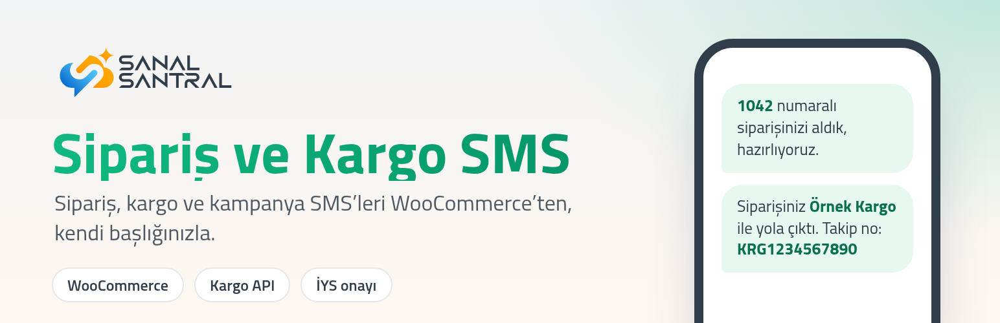
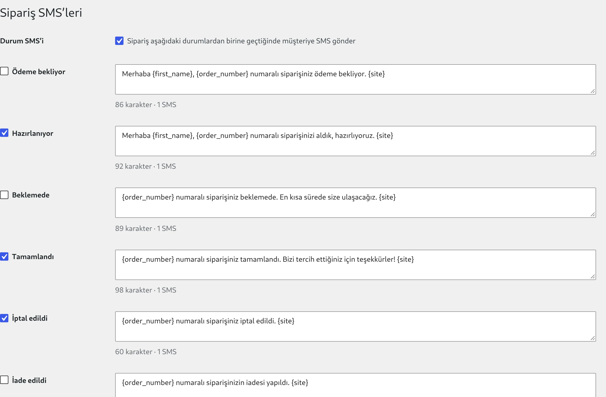
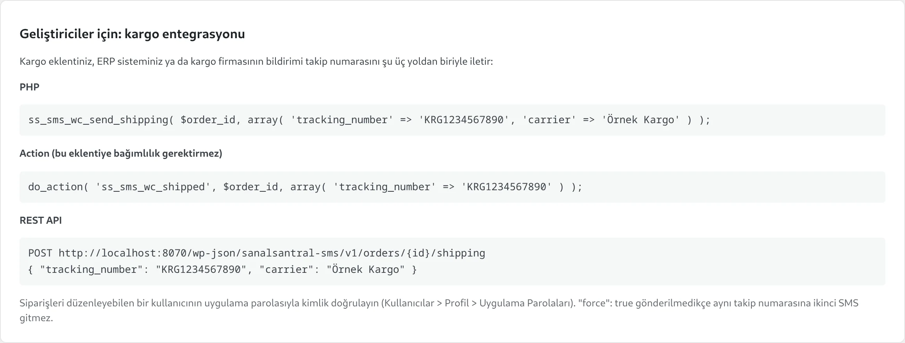
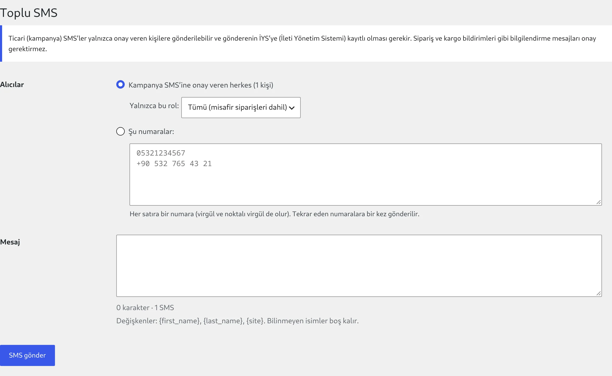
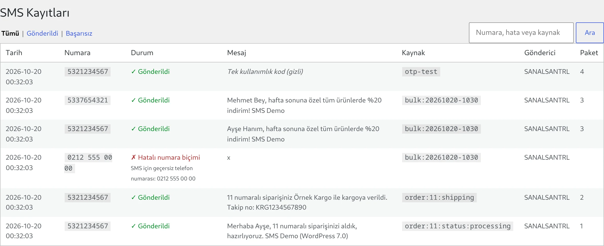
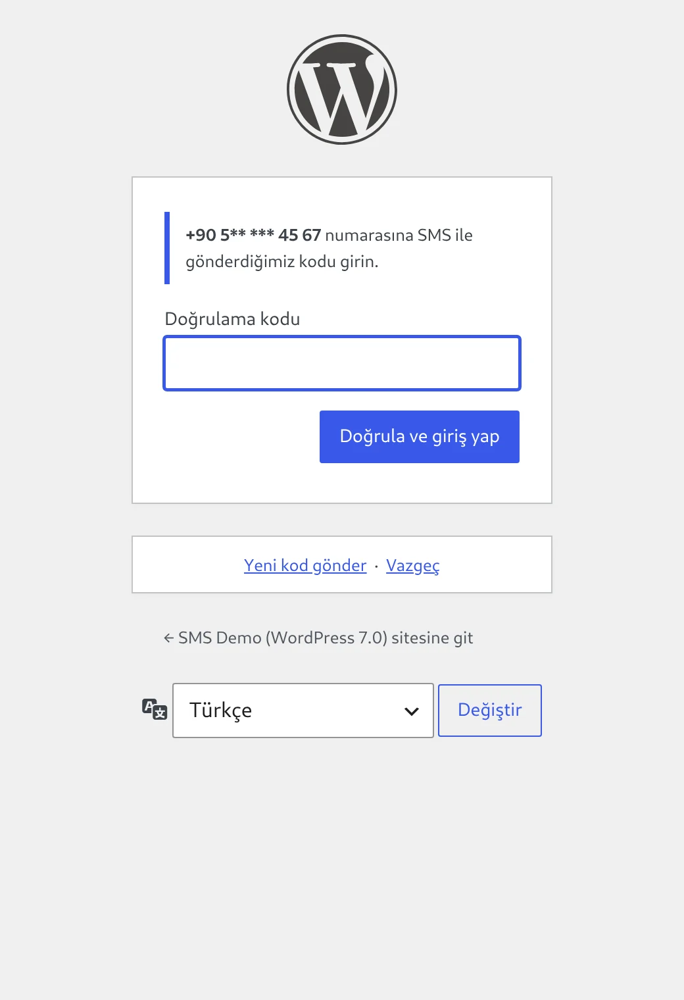
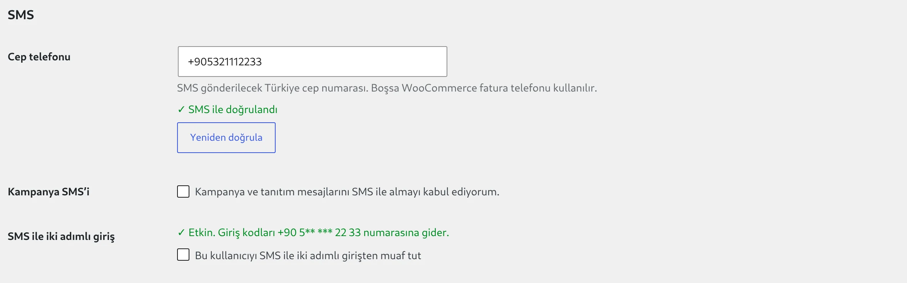

<p align="center"></p>

# Sanal Santral SMS for WordPress

WooCommerce mağazanızın sipariş, kargo ve kampanya SMS'lerini kendi başlığınızla gönderin; müşteri ve yönetici girişlerini SMS koduyla koruyun. Kurulum birkaç dakika, panel tamamen Türkçe.

**[Eklentileri indir](https://github.com/Sanal-Santral/wordpress-sms-sanalsantral/releases/latest)** · **[SMS paketleri](https://www.sanalsantral.com.tr/sms-paketleri)** · **[Hemen başla](https://satis.sanalsantral.com.tr/home?flow=sms)**

| | |
|---|---|
| **Sanal Santral SMS** | Sipariş durumu ve kargo SMS'leri, onaylı kampanya gönderimi, SMS kayıtları |
| **Sanal Santral SMS OTP** | Tek kullanımlık SMS kodu ve SMS ile iki adımlı giriş |

---

## Sipariş SMS'leri kendiliğinden gider

Sipariş "Hazırlanıyor", "Tamamlandı" ya da "İptal edildi" olduğunda müşteriye SMS gider. Her durum için ayrı şablon, müşteri adı, sipariş numarası, tutar gibi değişkenler. Gönderilen her SMS siparişe not olarak düşer.



## Kargo SMS'i, entegrasyonunuzdan

Takip numarası kargo eklentinizde ya da ERP'nizde oluştuğu anda müşteriye kargo SMS'i gider. Tek satır PHP, bir WordPress action'ı ya da REST çağrısı yeterli. Aynı takip numarasına ikinci SMS gitmez.



## Kampanyalar yalnızca onay verenlere

Ödeme sayfasındaki onay kutucuğuyla izin toplayın; kampanyanızı onaylı müşterilerinize ya da kendi listenize, isme özel gönderin. Onay zamanı kaydedilir, tekrar eden numaralara tek SMS gider.

<p>


</p>

## Her gönderim kayıt altında

Gönderilen ve başarısız her mesaj; numara, Türkçe hata nedeni, kaynak ve paket numarasıyla listelenir. Hatalı numaralar gönderilmeden ayıklanır, tek bozuk numara toplu gönderimi durdurmaz, yanıtı belirsiz kalan mesajlar asla iki kez gönderilmez.



## SMS ile güvenli giriş

Parola doğru girildiğinde oturum hemen açılmaz; telefona gelen kodla açılır. WooCommerce Hesabım ve WordPress giriş sayfasında çalışır.

- Yönetici girişi için ayrı ve varsayılan olarak kapalı ayar
- Kod yalnızca SMS ile doğrulanmış numaraya gider; yöneticinin kilitlenme riski en aza iner
- Bekleme süresi, saatlik sınır ve deneme hakkıyla SMS krediniz korunur
- Kendi formlarınız için OTP API'si

<p>


</p>

---

## Kurulum

1. [Releases](https://github.com/Sanal-Santral/wordpress-sms-sanalsantral/releases/latest) sayfasından `sanalsantral-sms.zip` (ve isterseniz `sanalsantral-sms-otp.zip`) dosyasını indirin.
2. WordPress panelinde *Eklentiler > Yeni Eklenti Ekle > Eklenti Yükle* ile yükleyip etkinleştirin.
3. *Sanal Santral SMS > Ayarlar*'da API kullanıcı adı ve anahtarınızı girin, göndericileri senkronize edin, test SMS'i atın.

Sunucuda tek komutla:

```sh
curl -fsSL https://raw.githubusercontent.com/Sanal-Santral/wordpress-sms-sanalsantral/main/install.sh \
  | sudo -u www-data sh -s -- --path=/var/www/html --username=API_KULLANICI --api-key=API_ANAHTARI
```

Yeni sürümler WordPress'in *Eklentiler* ekranında görünür, tek tıkla güncellenir. Ayrıntılı anlatım: [SMS kurulum ve kullanım](docs/sanalsantral-sms-kurulum.html) · [OTP kurulum ve kullanım](docs/sanalsantral-sms-otp-kurulum.html)

**Gereksinimler:** WordPress 7.0 veya 7.1, PHP 7.4+, Sanal Santral SMS hesabı. Sipariş ve kargo SMS'leri için WooCommerce.

## İletişim

- Telefon: [0850 441 00 00](tel:08504410000)
- WhatsApp: [0850 441 08 51](https://wa.me/908504410851)
- [sanalsantral.com.tr](https://www.sanalsantral.com.tr/sms-hizmeti)

## Marka notu

WordPress®, WordPress Foundation'ın; WooCommerce®, Automattic Inc.'in tescilli markasıdır. Sanal Santral'ın bu kuruluşlarla ve belgelerde adı geçen diğer ürünlerle bir bağlantısı yoktur; adlar yalnızca uyumluluğu belirtmek için kullanılmıştır. Örneklerdeki kargo firması adları ve takip numaraları temsilidir.

## Lisans

GPL-2.0-or-later
